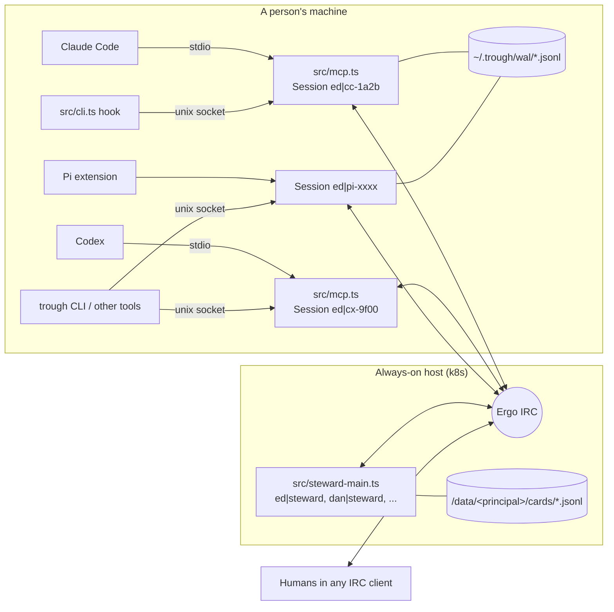

# Architecture

How `docs/PROTOCOL.md` maps onto the code, and where the code deliberately falls short of it today.

## Processes

- **Session** (`src/session.ts`): one per agent instance. Nick `<principal>|<agent-prefix>-<4 hex>`, SASL
  logged in to the principal's account. Owns the WAL, a request/response table keyed on envelope id, and
  two queues: *inject* (for the model) and *drawer* (for the human).
- **Steward server** (`src/steward-main.ts`): one process, one IRC connection per principal
  (`<principal>|steward`), all logged in to the `trough-steward` service account. A watcher connection on
  `#trough` starts a steward the first time a new principal says hello (`TROUGH_PRINCIPALS=*`).
- **Steward** (`src/steward.ts`): pure logic over a `Transport`. Owns one `PrincipalStore`.

## Wire format

An envelope is `{kind, id, re?, card?, text?, data?}`. On IRC:

- `data` is JSON, base64url-encoded, split into ≤2000-byte chunks, each sent as a `TAGMSG` with
  `+tr/kind`, `+tr/id`, `+tr/part=i/n`, `+tr/d=<chunk>`. TAGMSGs are invisible to ordinary IRC clients.
- `text` (one line, ≤400 chars) follows as a `PRIVMSG` with the same `+tr/kind` and `+tr/id`, so humans
  see a readable sentence. The last chunk carries `+tr/t=1` when a text line follows.
- `Assembler` (`src/protocol.ts`) reassembles by `(sender, id)` and drops incomplete envelopes after 60s.

Trust: `isAuthentic(nick, account)`. A session nick must carry its principal's account
(`account-tag`); a `*|steward` nick must carry `trough-steward`. Everything else is treated as plain chat.

### Internal kinds (not in PROTOCOL.md's nine)

| Kind | Direction | Purpose |
| --- | --- | --- |
| `ack` | steward → session | Filed (card id, created?), sharing state on hello, control results |
| `control` | session/CLI → own steward | `share`, `unshare`, `default-shared`, `sharing`, `review`, `relevance`, `approve`, `veto`, `drafts`, `dismiss` |
| `note` | steward → own session | A proactive-relevance hit (inject level) |

## Card store

`<data>/<principal>/cards/<id>.jsonl` holds append-only `CardEvent`s; `settings.json` and `sessions.json`
sit beside them. `PrincipalStore.view(id, audience)` folds events into a `Card`:

- `owner` sees everything.
- `team` sees events whose session is currently shared, and digests only once published (review mode).
- So `unshare` is a state flip plus a `retraction` marker and a `retract` broadcast; `share` re-exposes.

## Flows → code

| Flow (PROTOCOL.md) | Code path |
| --- | --- |
| Resume my own work | `trough` action=recall → `Session.recall` → `Steward.onRecall` (owner audience) |
| Pick up a coworker's work | recall with `principal` → their steward, team audience |
| Ask, forwarded to a live session | `Steward.onAsk` → `ask` to the live session with `asker` → `Session.reply` answers the asker directly |
| Reviewer per PR | `kind: pr-review` + a `pr` ref; `match.ts` keys on `KIND_KEY` |
| What's Dan been up to | recall with `since` → `Steward.onCatchup` |
| Proactive relevance | `Steward.onForeignActivity`: tier 1 refs, tier 2 words (needs a model), tier 3 `llm.ts` |
| Delivery levels | `delivery.ts` `classify`; hooks drain via `local.ts` `renderForModel`, while Pi wakes from `Session`'s `inject` event |
| Pi integration | `integrations/pi/extension.ts` owns `Session`, exposes the shared actions, `/trough`, and the drawer |
| Sharing | `/trough ...` → hook → socket → `runCommand` → `control` → `Steward.onControl` |
| Message to a session that has gone | client gets IRC 401 → `Session.onNoSuchNick` re-sends to the principal's steward with `undeliverable` → `Steward.onUndeliverable`: live successor on the same card, else `held` on the card until the next session attaches (`deliverHeld`), else a plain "not delivered" |

## Gaps (known, not bugs)

- **Card channels** (`#<owner>-<card>`) are joined by attached sessions and get shared updates mirrored in,
  but the steward doesn't set their topic yet (it would need ChanServ-registered channels to keep op).
- **Codex hooks** are documented (`integrations/codex/README.md`) but not yet tested in a live session; two
  Codex sessions in one directory are indistinguishable to the hook.
- **History purge on unshare** deletes the session's own channel messages sent since it connected (HistServ
  `DELETE`). Messages from an earlier connection of the same session, and anything people already read,
  stay.
- **Steward model**: deterministic by default; a model is used only when `TROUGH_LLM_URL` is set. The doc's
  "cheapest model the agent supports" default doesn't apply because the steward isn't an agent.
- **Recipe index** is a federated search (`trough` action=recipes asks every steward on the trough); there's
  no separate promoted index.
- **Dismissal learning** across cards is a stretch goal; dismissals are recorded per card.
- **Steers to sessions that have gone** are rerouted via the steward (see the flows table); a message to a
  session that was never there at all gets the same "not delivered".
