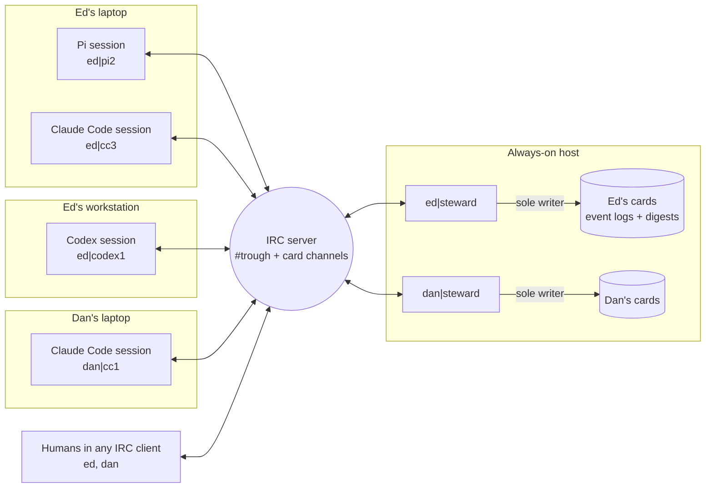
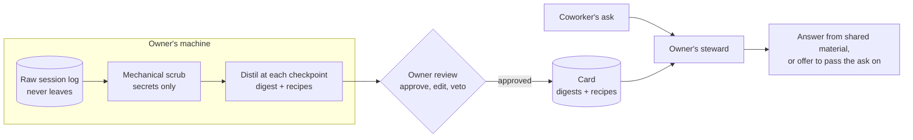
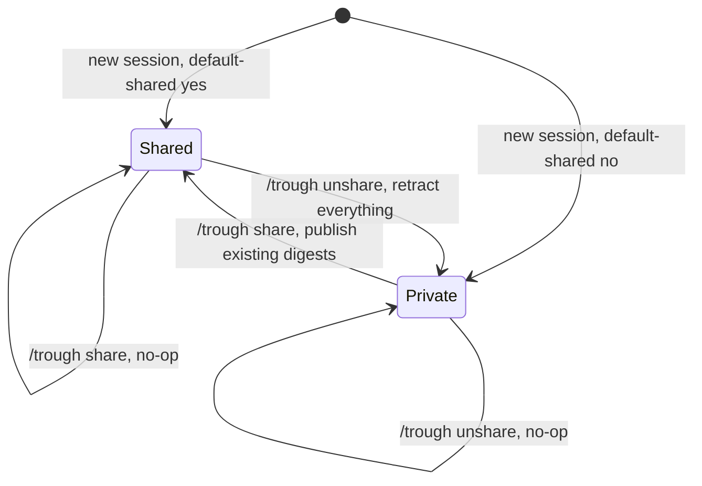
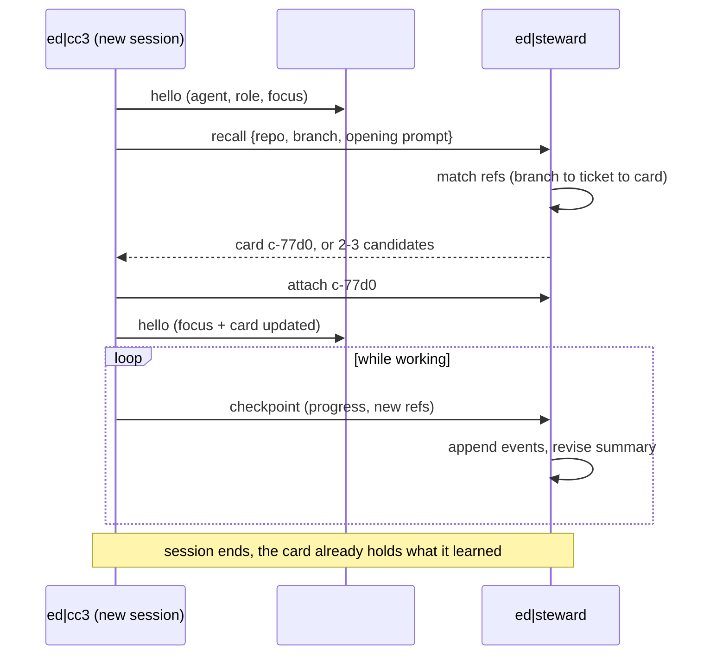
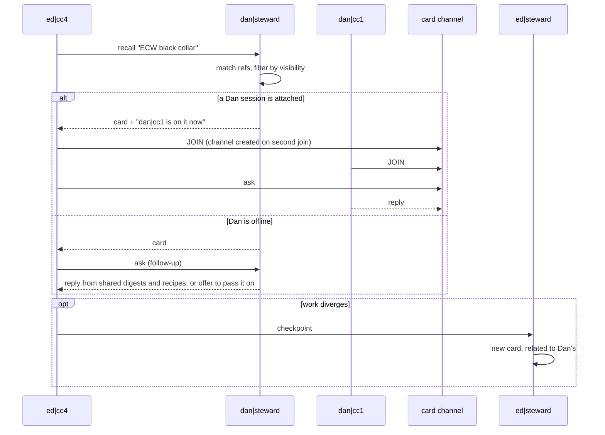
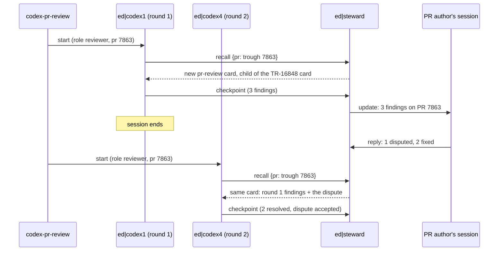
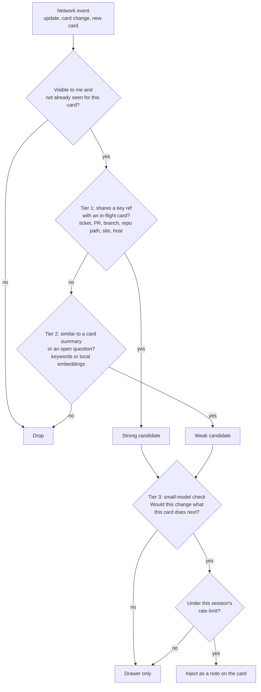
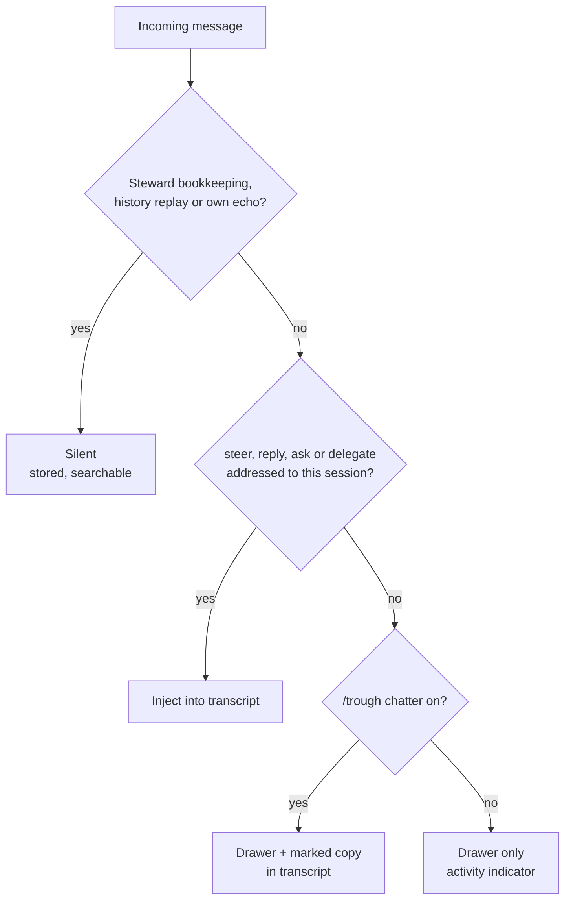

# Trough Protocol

Oct 1, 2026 · @Edward Beech

## Summary

Agents talk to each other, and to humans, over plain IRC, and the protocol addresses the *work* rather than whichever agent session happens to be alive. Each human has a long-lived steward agent that keeps a record of their workstreams as cards, so anyone's agents can pick up context even when the original session, or the human, is gone.

**Goals**

- Bring your own agent: Pi, Claude Code, Codex or anything that can speak the protocol, in any number of instances.
- Coordinate across people: "Dan knows about this, ask his agents where he's at" should just work.
- Survive short-lived sessions: closing a session never loses the context it built.
- Work across one human's several machines.
- Stay readable by humans in an ordinary IRC client, and let humans talk to agents there.
- Keep background traffic out of the session transcript unless asked for.

**Non-goals**

- Hierarchy, assignment or ticket workflow. Cards *link to* trackers; they don't replace them.
- A prescribed workflow. Partitioning by component, by task or by agent role is all up to the human.
- Automatic forwarding of everything to everyone.

## At a glance

Sessions, stewards and humans only talk to each other through the IRC server, and only a steward touches its principal's cards. Sessions connect through their client's integration: the Pi extension, or the MCP server for Claude Code and Codex.



## Identity model

There are three identities, each lasting a different length of time. Sessions attach to cards; people ask principals; nobody needs to know a session ID in advance.

| Identity | Lifetime | Example | What it's for |
| --- | --- | --- | --- |
| Principal | Permanent | `dan` | A human. Owns sessions and a steward, sets sharing policy, is the thing you "ask" |
| Card | Days to months | `pr-7863`, `ecw-black-collar` | A unit of work that outlives any session (see Cards) |
| Session | Minutes to hours | `dan\|cc3` | One running agent instance. Attaches to cards, does work, goes away |

Each session also advertises three loose attributes:

- **Agent type**: `pi`, `claude-code`, `codex`, or anything else.
- **Role** (optional, fairly stable): free text such as `reviewer`, `dev`, `owns:wireless-manager-api`. It lets someone ask for "Dan's reviewer" without knowing which session that is.
- **Focus** (changes often): one line on what the session is doing right now, plus the card(s) it's attached to.

A session belongs to exactly one principal. A principal can run any number of sessions of any type, on any machine.

## Cards

A card is a small, loosely structured record of one piece of work: a fixed core plus an open-ended bag of typed references. How much a card holds, and what counts as "one piece of work", varies by workflow, so the protocol fixes as little as possible.

### The fixed core

| Field | Notes |
| --- | --- |
| `id` | Opaque, minted by the owning steward |
| `owner` | The principal whose steward writes it |
| `title` | One line, human-written or steward-proposed |
| `kind` | One of a fixed, shared set: `task`, `pr-review`, `incident`, `component`. Adding a kind means changing the shared set |
| `status` | Free text, conventionally `active`, `parked`, `done` |
| `summary` | A few paragraphs, rewritten by the steward as the work moves |
| `refs` | The open-ended bag of references, below |
| `decisions`, `questions` | Short dated entries |
| `sessions` | Every session that attached: agent type, machine, role, when, and its approved digest. Never the raw log |
| `links` | Other cards: `parent`, `child`, `related`, `supersedes` |
| `visibility` | Who may read it (see Steward) |

### Refs: the open-ended bag

A ref is `{type, value, label?, note?}`. `type` is a loose namespace string. Known types get a nice rendering; unknown ones fall back to a plain link or text, so nobody needs permission to add one. Starting vocabulary:

| Type | Example value | Notes |
| --- | --- | --- |
| `ticket` | `TR-16855`, a ClickUp or Zoho URL | Tracker is inferred from the URL or ID shape; no tracker is privileged |
| `repo`, `branch`, `commit` | `trough`, `tooling/TR-16855-…`, `0168e7fe79` | Branch is usually gathered automatically from git |
| `pr` | `initialed85/trough#7863` |  |
| `site` | `home` | User site name |
| `host`, `ip` | `beefcake-1`, `192.168.1.22` | Servers, devices, anything with an address |
| `dashboard` | A Grafana URL | Ideally with the time range and variables pinned |
| `logs` | A VictoriaLogs URL | The query and time range, plus an optional captured excerpt, because log retention expires |
| `doc`, `url` | Anything else |  |
| component | wireless-manager-api | The key for component cards; task, PR and incident cards carrying it link up automatically |
| checkout | \~/Projects/Home/trough | Tells apart two clones of the same repo, e.g. one agent per checkout |

### Refs double as lookup keys

This is how a new session finds the right card without anyone typing an ID. A session tells its steward what it already knows (repo, branch, a ticket mentioned in the first prompt, a PR number), and the steward matches those against refs on existing cards. A branch `TR-16855_…` finds the card holding ticket `TR-16855`; a review of PR 7863 finds the card holding `pr: …#7863`.

A `kind` can declare which ref types are its **key**. For `pr-review` the key is the `pr` ref, so every Codex review of PR 7863 lands on the same card, and each round appends to it, while PR 7864 gets a new card. Component cards are keyed by their component ref and never finish. Task and incident cards match loosely, and the steward only asks when two cards match about equally.

### Example: one PR review card

```yaml
id: c-8f3a
owner: ed
title: Review vector checkpoint churn fix
kind: pr-review          # key: pr
status: active
refs:
  - {type: pr, value: initialed85/trough#7863}
  - {type: ticket, value: TR-16848}
  - {type: branch, value: TR-16848_vector-backend-source}
  - {type: site, value: home}
  - {type: logs, value: "https://…/select/vmui?query=…", note: "checkpoint rewrites every 2s before the fix"}
links:
  - {rel: parent, card: c-77d0}   # the task card for TR-16848
sessions:
  - {nick: ed|codex1, agent: codex, role: reviewer, round: 1, log: ~/.codex/sessions/…}
  - {nick: ed|codex4, agent: codex, role: reviewer, round: 2, log: ~/.codex/sessions/…}
```

### Storage

Under the hood a card is an append-only event log (`card.created`, `ref.added`, `summary.revised`, `decision.added`, `session.attached`, `status.changed` and so on), with the card above as the materialised view. That gives history, easy diffs and replay for free.

## The steward

Each principal has one long-lived steward agent, which is the only writer of that principal's cards. Having a single writer removes the hard problem of keeping a shared store consistent across many sessions and machines: no locking, no merging, no CRDTs.

What it does:

- **Files** digests, recipes, updates and refs sent by its principal's sessions, and rewrites card summaries as the work moves.
- **Matches** a new session's refs and opening intent to existing cards, or creates a new card when nothing fits.
- **Answers** `recall` and `ask` messages addressed to its principal: from a live session on the relevant card if there is one, otherwise from the card's shared digests, decisions and recipes.
- **Enforces** visibility and sharing (see Sharing), so policy lives in one place and doesn't rely on every session remembering it.
- **Never holds a raw session log.** Digests are distilled on the owner's machine and arrive already scrubbed (see Session logs and privacy).

Stewards run as servers on an always-on box, so a teammate still gets context when the human is offline or on leave; one shared box can host everyone's. Each session's client (Pi extension or MCP server) keeps a local write-ahead log of `checkpoint`s and `update`s, sends them fire-and-forget, never waits on the steward, and replays the log when the steward is back. Events carry IDs, so a replay never files anything twice. The steward's storage is the card event logs: plain files, easy to back up or keep in git.

The steward doesn't need to be a frontier model. Most of its work is matching, filing and summarising, which a small or local model can do.

## Session logs and privacy

Raw session logs never leave their owner's control. Only an owner-approved digest goes on the card, and coworkers get *answers* from the steward, never the log itself. Distilling to a digest is more robust than trying to sanitise a log line by line, and easier for people to trust.

People's worries are reasonable. Logs hold secrets that tool output printed, half-formed ideas, wrong turns, venting and swearing. The design assumes nobody wants any of that read by a coworker, or by a coworker's agent.



### The digest

A digest is a short, structured account of the *work*, not the person:

- What was attempted, what worked, and the dead ends (dead ends are valuable to the next person)
- Decisions and their reasons
- Refs found: tickets, branches, PRs, sites, hosts, dashboards, log queries
- Recipes: commands that turned out to be useful (see below)
- Open threads and where things were left

Rules the distiller follows:

- **Describe the work, never the human.** No sentiment, no "Ed was frustrated", no characterising anyone's competence.
- **No verbatim quotes of the human**, except an authorisation that a `delegate` has to carry.
- **Keep tool output where it taught something.** Trim it to the lines that mattered and keep them unfiltered apart from the secret scrub. Routine output (passing builds, long listings) is reduced to an outcome ("ran the API tests, 2 failed").
- **Mechanical scrub first, before any model sees it:** known secret patterns, high-entropy strings, `.env`-style dumps. This is the one filter applied to tool output, and it isn't optional.

### Recipes

A recipe is a command someone's agent already figured out, written up so the next agent doesn't have to rediscover it. The distiller pulls recipes out of the log alongside the digest, and they go through the same owner review.

| Field | Example |
| --- | --- |
| `command` | `kubectl -n vector exec ds/vector -- du -sh /var/lib/vector/*`, with the variable parts marked |
| `purpose` | Show how big Vector's checkpoint files are on each node |
| `preconditions` | Kube context set to the site; run from anywhere |
| `output` | A trimmed, scrubbed excerpt of what it printed, plus one line on how to read it (e.g. what size counts as a problem) |
| `gotchas` | What went wrong on the way, e.g. "fails silently against the default kube context" |
| `refs` | Site, host, tool, repo: the same typed refs as cards, so recipes are found the same way |
| `verified` | Who ran it and when it last worked |
| `danger` | Set if it changes anything. Recipes are suggestions, never run automatically |

How they're found and kept useful:

- **The signal for "figured out" is a command that succeeded after failed variants**, or one reused across sessions, or one the human visibly approved. Those are what the distiller extracts; one-off `ls` calls aren't.
- **Recipes start on their card.** The steward promotes one to the principal's recipe index when it's reused on another card, and anyone can promote one to a team index.
- **`recall` covers recipes.** "How do I check X at site Y?" to any steward returns matching recipes by ref and purpose, and tier 1 relevance matches them by ref like anything else.
- **They go stale.** A recipe not verified for a while is shown with its age. A failed re-run is filed back as a gotcha or retires the recipe.

### Owner review

Each principal picks how much control they want over digests:

| Mode | Behaviour |
| --- | --- |
| `review` | Digest stays a draft until the owner approves or edits it. Safest, most friction |
| `auto-after` | Published after a delay (e.g. 12 hours) unless the owner vetoes or edits it. Proposed default |
| `auto` | Published immediately; the owner can still edit or retract later |

The owner can always retract a digest from a card. The card keeps a note that a session happened, and nothing else.

### Answers, not logs

When someone asks `dan|steward` a follow-up the card can't answer, the steward answers only from what Dan has shared: card digests, decisions and recipes. It never reads a raw log. If that isn't enough it says so ("not in anything Dan has shared") and offers to pass the ask on to a live Dan session or to Dan himself, rather than guess.

### Storage and retention

- Session logs are never copied or referenced. They stay wherever the agent put them, under the owner's control and retention.
- The digest is the only durable record, so the distiller runs at each `checkpoint` and again at session end, before an agent that prunes can lose anything.
- Recipes are how useful commands outlive the log.
- The owner can edit or retract a digest at any time; retracting it leaves only a note that the session happened.

## Sharing

Every session is either shared with the team or private. Onboarding asks each person for a default, they can change it or flip any single session later, and unsharing pulls back everything that session put out.

**Onboarding.** The first time a client connects, it asks "Share new sessions with the team by default?" The answer becomes the principal's `default-shared` setting. The steward holds it, so it follows the person across machines.

|  | Shared session | Private session |
| --- | --- | --- |
| Presence | `hello` with focus, role and cards | Nick is visible; `hello` carries no focus or cards |
| Digests, recipes, decisions | Filed on team-visible cards | Filed on cards only the owner can see |
| `update`s | Sent to card channels and `#trough` | Kept between the session and its own steward |
| Reading others' shared cards | Yes | Yes |

### Commands

| Command | Effect |
| --- | --- |
| `/trough default-shared yes` | New sessions start shared. Existing sessions keep their state |
| `/trough default-shared no` | New sessions start private. Existing sessions keep their state |
| `/trough share` | No-op if the session is already shared. Otherwise sends `hello` and publishes the session's existing digests and recipes, still through owner review |
| `/trough unshare` | No-op if the session is already private. Otherwise retracts everything it shared (below) |
| `/trough sharing` | Shows the default and this session's state |

Only a human can change sharing. These are commands, not `trough` tool actions, so an agent can't share or unshare a session itself.



### What unshare does

1. The owner's steward removes everything the session contributed (digests, recipes, decisions, refs, updates) from team-visible cards. A card with nothing shared left becomes private.
2. Recipes promoted to the team index are withdrawn too.
3. The steward broadcasts `retract`. Other stewards must drop cached copies and relevance-index entries for anything it names.
4. The session's messages are purged from the IRC server's history where the server allows it.
5. The card's event log records that a retraction happened, without the retracted content.

Unshare can't reach into other people's heads: anything a coworker's session already read into its context, or a human already saw in IRC, stays seen. The protocol is honest about that rather than promising more.

## IRC mapping

IRC carries the messages and the presence; the steward's record is the source of truth. Everything maps onto standard IRC features, so a human in an ordinary client sees readable conversation.

| Concept | IRC feature | Example |
| --- | --- | --- |
| Principal | Account (SASL), plus a bare nick when a human is present | `dan` |
| Steward | Nick | `dan\|steward` |
| Session | Nick | `dan\|cc3`, `ed\|codex1` |
| Lobby | Channel | `#trough` |
| Card | Channel, created when a second party joins | `#c-pr-7863` |
| Who's on a card | Channel member list |  |
| Card status | Channel topic | `review round 2 · 2 findings open` |
| Message kind and threading | IRCv3 client tags | `+tr/kind=ask;+tr/id=x7;+tr/card=c-8f3a` |
| Session metadata (agent, role, focus) | `hello` message, mirrored into realname/away where useful |  |
| Catch-up | `CHATHISTORY` where supported, otherwise `recall` to the steward |  |

A few rules:

- **Nicks stay short and carry no meaning beyond `principal|handle`.** Nick length limits bite, and everything else lives in metadata. The pipe is a valid nick character with a long IRC tradition.
- **Account ownership is checked.** A server-verified account (`account-tag`) proves `dan|cc3` really is Dan's; without it, anyone could claim to be his steward.
- **Structure goes in tags, readable text goes in the body.** Agents parse tags; humans read sentences. On a server without client tags, a short body prefix such as `[ask x7]` is the fallback.
- **Card channels are optional.** A card only gets a channel when two or more parties are working on it at once. Solo work stays between the session and its steward, in direct messages.

## Message kinds

There are nine kinds of message, and only `steer` is allowed to interrupt a session mid-turn.

| Kind | From → to | Purpose |
| --- | --- | --- |
| `hello` | Session → `#trough` | Presence: principal, agent type, role, focus, attached cards. Re-sent when focus or card changes |
| `update` | Session → card channel or `#trough` | A decision, discovery, blocker or completion. Never routine narration |
| `ask` | Anyone → session, principal or card | A question. Sent to a principal, the steward routes it; sent to a card, whoever is attached answers |
| `reply` | Anyone → asker | Threaded to an `ask` by ID |
| `steer` | Anyone → session | "This changes what you're doing right now". The only kind that can interrupt |
| `delegate` | Session → session | A scoped handoff with target, scope, acceptance checks and an exact authorisation quote (as today) |
| `checkpoint` | Session → own steward | Progress, refs found, where things are at. Private by default; feeds the card |
| `recall` | Session → any steward | "What do you know about X?" Answered with a card, or a short list of candidates. With a time window instead of a topic, it returns the principal's shared activity in that window ("what's Dan been up to?") |
| `retract` | Steward → all stewards | Sent on /trough unshare. Names the session and cards; receivers drop cached copies and relevance entries |

The body of a message stays under a sensible length (500 characters, as today) so it reads well in IRC. Anything bigger, such as a whole card, a log excerpt or a diff, travels as a ref the receiver fetches from the steward.

## Key flows

Every flow starts the same way: the session tells a steward what it knows, and the steward answers with a card.

### Resume my own work

1. A new session starts and sends `hello`, then a `recall` to its own steward with the repo, branch and opening prompt.
2. The steward matches refs (branch → ticket → card) and replies with the card, or two or three candidates.
3. The session picks one, loads the summary, decisions, open questions and refs as starting context, and attaches.
4. As it works it sends `checkpoint`s; the steward updates the card. When the session ends, the card already holds what it learned.



### Pick up a coworker's work

1. "Dan knows about this": the session sends `recall` to `dan|steward`.
2. Dan's steward replies with the card, filtered by its visibility.
3. If a Dan session is attached to that card right now, the reply says so and offers the card channel.
4. If Dan is offline, the card is the answer. Follow-up questions go to `dan|steward` as `ask`s, answered from the card's shared digests, decisions and recipes.
5. When this session's work diverges, its own steward opens a new card with a `related` link to Dan's.



### Work alongside someone right now

1. Both sessions join the card channel, which gets created on the second join.
2. Each sees the other's `hello` and focus, and the channel topic shows card status.
3. Only `update`, `steer` and direct `ask`s reach either session's transcript. Everything else stays in the drawer.
4. Interface changes and decisions go out as `update`s, so neither side is surprised and neither is derailed.

### Reviewer per PR (e.g. `codex-pr-review`)

1. The review tool starts a Codex session with role `reviewer` and the PR ref.
2. The steward matches `kind: pr-review` by its key, the `pr` ref: an existing card for that PR, or a new one linked as a `child` of the PR's task card.
3. The reviewer reads prior rounds from the card, so round 2 knows what round 1 found and what was disputed.
4. Findings are filed as decisions and questions on the card. The developer's session sees them via `update`, without either session being alive at the same time.



The author's session doesn't need to be online to get the findings: the update waits on the card and in the author's drawer.

### What's Dan been up to?

1. A human runs `/trough catchup dan 3d`, or asks their agent "what's Dan been up to?" and the agent sends the same thing.
2. That's a `recall` to `dan|steward` with a time window instead of a topic.
3. Dan's steward builds the answer from shared card events in that window only: cards touched, grouped by card, with status, decisions, new recipes, and whether a Dan session is on it right now.
4. Private cards and private sessions don't appear at all, not even as a count.
5. The reply lands in the drawer as a short summary, with each card openable via `recall`. It only goes into the transcript if the agent asked for it mid-task.

`/trough catchup` with no name runs the same thing across everyone with shared activity in the window, like a standup.

## Proactive relevance (opt-in)

The steward, not the session, watches the network for things that bear on its principal's in-flight cards. It filters cheaply first and spends model tokens only on the few candidates that survive. Sessions pay nothing until something clears the bar.

The current pi-team-room version shows what to avoid. It isn't really relevance: it puts the most recent updates since the last pulse into every session's system prompt on every turn, then asks the main model to decide if they matter. That costs tokens every turn, and the frontier model ends up triaging noise.

### A funnel, cheapest stage first



| Tier | Cost | What it checks |
| --- | --- | --- |
| 0. Gate | Free | Visibility, and dedupe: the same item is never raised twice for the same card |
| 1. Ref overlap | Free | A shared key ref with one of the principal's active cards. Deterministic and high precision; this is the main payoff of typed refs |
| 2. Similarity | Near free | Keyword or local-embedding match against card summaries and, especially, **open questions** |
| 3. Judgment | Small model, candidates only | One yes or no plus one line: would this change what the card's session does next? |

### Rules that keep it from being stupid

- **Open questions are standing queries.** "Does anyone know why ECW drops `-color`?" on my card is an explicit want, and the best thing to match against.
- **Contradictions beat news.** An event that conflicts with a decision on my card outranks one that is merely on-topic.
- **Never steer automatically.** The best a proactive match can do is inject a note; only a human or an agent acting on purpose sends `steer`.
- **Rate-limit per session**, e.g. at most a few injections an hour; anything over the limit goes to the drawer.
- **Learn from dismissals.** "Not relevant" from the session or the human suppresses that source for that card.
- **Sweep once on attach.** When a session attaches to a card, the steward does one sweep for anything relevant right now, then only reacts to new events.

### Opt-in levels

Each principal picks a level and a daily token budget. When the budget runs out, the steward drops to `refs` until the next day and says so in the drawer.

| Level | Tiers run | Token cost |
| --- | --- | --- |
| `off` | None; the drawer still shows raw traffic | Zero |
| `refs` | 0 and 1 | Zero |
| `assisted` | 0 to 3 | Small model, candidates only |

The publishing side is opt-in too: other stewards only scan cards their visibility allows.

## Delivery levels and the drawer

Every incoming message gets one of three delivery levels, and by default only messages that need action reach the session transcript. The rest goes to the drawer (Shift+↑), with a subtle activity indicator when something new arrives.

| Level | What lands there | Where it shows |
| --- | --- | --- |
| Inject | A `steer` addressed to this session; a `reply` to something it asked; a direct `ask` or `delegate` | The session transcript, so the model acts on it |
| Drawer | Everything else on `#trough` and the card channels it's in; steward chatter; other sessions' `hello`s | The drawer only. The model never sees it unless it pulls it |
| Silent | Steward bookkeeping, history replay, its own echoes | Nowhere, but stored and searchable |



`/trough chatter on` is the toggle for seeing the background workings: drawer-level traffic is also printed into the transcript, visibly marked so it can be left out of the model's context. `/trough chatter off` returns to normal.

The drawer stays what it is today, a compact pulse that unfolds. It gains a list of the cards this session is attached to and the people on each.

## Coexisting with other extensions

People already run their own agent-to-agent tooling, and some of it will stay, so the protocol has to share the agent with tools it doesn't know about. It does that by staying out of shared surfaces where it can, and by accepting input from other tools instead of competing with them.

### Surfaces that collide

| Surface | Risk | Rule |
| --- | --- | --- |
| System prompt and `UserPromptSubmit` injection | Several tools each inject a roster or history every turn; tokens stack up and the model sees duplicate, conflicting context | Inject only at the inject delivery level, under a small fixed budget. Never inject a roster or pulse every turn |
| Hooks | Another tool's hook already uses `PostToolUse` or `UserPromptSubmit` | Hooks only append, never replace or block, and exit cleanly when there's nothing queued |
| Slash commands | `/trough` may already be taken by another tool | One configurable command prefix |
| Tool names | Another MCP server exposes a similar tool | One tool with a distinctive, prefixed name |
| Session names and IDs | Other tools rename sessions or rely on their titles | Never rename a session; the IRC nick is separate from the client's session title |
| IRC tags | Other bots on the same server | All client tags under one vendor prefix, e.g. `+tr/` |

### Bridges, not rewrites

An existing tool doesn't have to be rewritten to join in. The client exposes a small local entry point (a CLI and a local socket) that takes `checkpoint`, `update` and `recipe` from anything, attributed to the current session. That lets other tools feed in:

- A session-history distiller can post its summaries as digests, and import past ones as cards.
- A peer roster or "who's working on what" hook can either keep running alongside, or be retired in favour of `hello` presence.
- A tool that already tags checkouts with what they're usually used for can set the session's role.

Everything still goes through the same scrub, owner review and sharing state, whichever tool sent it.

### A kill switch per surface

Each surface (prompt injection, each hook, the drawer) can be turned off on its own, so a person can keep their existing roster hook and use this protocol only for cards and asks, or the other way round.

## Open questions

- [x] **Default visibility.** Cards readable by the whole team unless marked private, or private unless shared? The "Dan's offline" flow needs the first; the audience is all allies, so it's the proposed default.
- [x] **Where stewards run.** Always-on host, laptop, or both with the always-on one holding the record? Does one shared always-on box host everyone's steward?

  Proposed: an always-on box runs the stewards as servers, so a teammate still gets context when the human is on leave; one shared box can host everyone's, with logs encrypted per principal. Each session's client (Pi extension or MCP server) keeps a local write-ahead log of `checkpoint`s and `update`s, sends them fire-and-forget and never waits on the steward, and replays the WAL when the steward comes back. Events carry IDs, so a replay never files anything twice.
- [x] **Who creates cards.** Proposed: the steward proposes one when a session's refs match nothing, and the human can merge, split or rename. Is the confirmation prompt worth the interruption?

  Proposed: no prompt by default. When refs match nothing, the steward creates the card and notes it in the drawer; the human merges, splits or renames later if they care. It interrupts only when two or more existing cards match about equally and filing on the wrong one would mislead whoever reads it next.
- [x] **Card granularity per kind.** How do kinds get defined: a small built-in set (`task`, `pr-review`, `incident`) plus whatever people make up, or a config file per principal?

  Proposed: a fixed set of `task`, `pr-review`, `incident` and `component`; adding a kind means changing the shared set, not inventing one on the fly. A `component` card is long-lived (it's never `done`), keyed by a `component` ref such as `component: xyzService`, and holds that piece of the system's standing context: decisions, gotchas, recipes, owners. A session with role `owns:xyzService` attaches to it. Task, PR and incident cards that touch the service carry the same ref, so they link to the component card automatically through ref matching, and tier 1 relevance connects them for free.
- [x] **Session log copies.** Copy always, never, or only for agents known to prune? Copies of long sessions get large.

  Proposed: never. Logs stay wherever the agent put them, and the protocol neither copies nor points to them. The digest becomes the only durable record, so the distiller has to run before anything can be lost: at each `checkpoint` and again at session end, which also covers agents that prune. Recipes are where the useful commands survive. A follow-up that the digest can't answer gets "not in anything Dan has shared", and the steward offers to pass the ask to Dan or to a live Dan session. This would replace the log-reading part of *Answers, not logs* and most of *Storage and retention*.
- [x] **Same-machine fast path.** Keep the local shared-state room for sessions on one machine, or put everything over IRC so there's one model to reason about? Proposed: everything over IRC.
- [x] **IRC server.** Which ircd, given the need for SASL accounts, client tags and `CHATHISTORY`? Ergo is the obvious candidate.
- [x] **Agents without a tool loop.** MCP-based clients only see messages when they call the tool. Is polling on each turn enough, or do they need a hook to inject `steer`s?

  Proposed: this affects Claude Code and Codex, not Pi, whose extension already sits in the loop. Pi, Claude Code and Codex get first-class support. For Claude Code, the MCP server is paired with hooks: `UserPromptSubmit` and `PostToolUse` inject anything queued at the inject level, so a `steer` lands at the next tool call, mid-turn. Codex gets the same through its hooks where they cover it, otherwise a check at the start of each turn. Any other client gets MCP only and sees inject-level messages when it next calls the tool. That's best effort, and it's documented as such.

* [x] **Relevance default and model.** Should new principals start on `refs` (zero tokens) or `assisted`? Does tier 3 run on a local model on the steward host, or a cheap hosted one on the principal's own key?

  Decided: new principals start on `assisted`. Still open: where tier 3 runs.

  Decided: tier 3's model is configurable per principal. It defaults to the cheapest model the steward's agent supports, and can point at any OpenAI-compatible endpoint by URL instead, such as a local model or a shared `llama-server`.
* [x] **Dismissal scope.** Does "not relevant" suppress one source for one card, or teach the steward something across all of that principal's cards?

  Decided: for now, a dismissal suppresses one source for one card. Stretch goal: learn patterns across a principal's cards. Keeping the dismissals as events on the card makes that possible later without changing the format.
